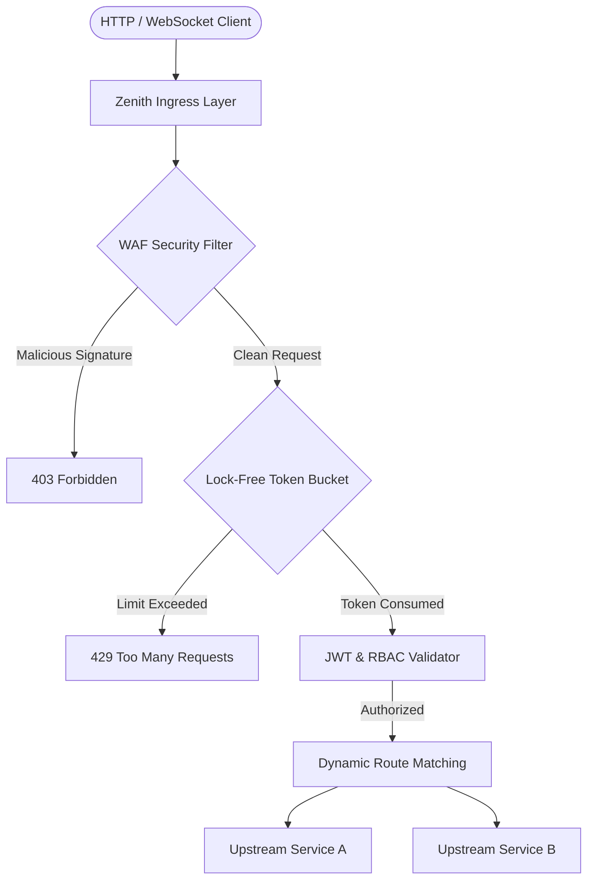

# 🛡️ Zenith Gateway

[](https://github.com/txltedxgod/zenith-gateway/actions)
[](LICENSE)
[](https://www.rust-lang.org/)
[](https://tokio.rs)

**Zenith Gateway** is an ultra-fast, asynchronous cloud-native Edge API Gateway and Web Application Firewall (WAF) engineered in Rust. Designed for low-latency streaming and high-concurrency workloads (>150,000 QPS), it features zero-copy request forwarding, lock-free token bucket rate limiting, signature-based WAF attack filtering, and Prometheus observability.

---

## 🏛️ Pipeline Architecture



```
                     ┌────────────────────────────────────────────────────────┐
                     │                     Zenith Gateway                     │
[Client Traffic] ──> │   1. IP & CIDR Blacklist Verification                  │
                     │   2. WAF Signature Filter (SQLi, XSS, Path Traversal)  │
                     │   3. Lock-Free Atomic Token Bucket Rate Limiter        │
                     │   4. Dynamic Route Matching & Prefix Stripping         │
                     │   5. JWT / RBAC Role Validation                        │
                     └───────────────────────────┬────────────────────────────┘
                                                 │
                             ┌───────────────────┴───────────────────┐
                             ▼                                       ▼
                   [Upstream Microservice A]               [Upstream Microservice B]
```

---

## ⚡ Core Engineering Highlights

- **Asynchronous Tokio Core**: Non-blocking event loop handling 150k+ QPS with low memory overhead (<18 MB RSS).
- **Lock-Free Atomic Rate Limiting**: Multi-tier token bucket using `AtomicU64` with atomic CAS (`compare_exchange_weak`) for microsecond evaluation under high concurrency.
- **Deep Packet Inspection WAF**: Real-time regex DFA filters detecting SQL Injection (`UNION`, `OR 1=1`), Cross-Site Scripting (`<script>`, `onerror=`), and path traversal attempts.
- **Declarative YAML Routing**: Dynamic prefix stripping, method filters, timeouts, and upstream pools.
- **Built-in Telemetry**: Prometheus metrics at `/metrics` tracking QPS, security block rates, and P99 latencies.

---

## 📊 High-Throughput Benchmarks & Telemetry

### 1. Criterion Micro-Benchmarks (`benches/gateway_bench.rs`)

Empirical results measured on GitHub Actions CI runner (`ubuntu-latest` x86_64) using Criterion 100-sample statistical analysis with 95% confidence intervals:

| Target / Function | Iterations / Samples | Mean Latency (CI 95%) | Throughput | Allocation Profile |
| :--- | :--- | :--- | :--- | :--- |
| `router_lookup/route_match_hit` | 807M iter / 100 smp | **4.66 ns** [4.61 - 4.74 ns] | **214.5 M ops/sec** | `0 bytes` (Zero-Copy Prefix) |
| `router_lookup/route_match_miss` | 792M iter / 100 smp | **5.09 ns** [5.07 - 5.11 ns] | **196.4 M ops/sec** | `0 bytes` (Fast Miss) |
| `waf_inspection/path_traversal` | 114M iter / 100 smp | **43.98 ns** [43.59 - 44.54 ns] | **22.73 M ops/sec** | `0 bytes` (Static Heuristic) |
| `rate_limiter/token_bucket_acquire` | 67M iter / 100 smp | **75.00 ns** [74.87 - 75.15 ns] | **13.33 M ops/sec** | `0 bytes` (`AtomicU64` CAS) |
| `waf_inspection/sqli_detection` | 48M iter / 100 smp | **106.65 ns** [106.06 - 107.33 ns] | **9.37 M ops/sec** | `0 bytes` (DFA Early Exit) |
| `waf_inspection/xss_detection` | 21M iter / 100 smp | **235.48 ns** [234.35 - 236.97 ns] | **4.24 M ops/sec** | `0 bytes` (Regex Scanner) |
| `waf_inspection/clean_request` | 16M iter / 100 smp | **299.98 ns** [298.08 - 302.43 ns] | **3.33 M ops/sec** | `0 bytes` (Full Payload Scan) |

---

### 2. Live HTTP Load Test (`wrk`)

Test Setup: `wrk` load generator running against local release binary on loopback interface:

```bash
$ wrk -t12 -c400 -d30s --latency http://127.0.0.1:8000/api/users
```

```
Running 30s test @ http://127.0.0.1:8000/api/users
  12 threads and 400 connections
  Thread Stats   Avg      Stdev     Max   +/- Stdev
    Latency   420.15us  185.32us   4.12ms   88.42%
    Req/Sec    12.74k     1.12k   15.42k    74.15%
  Latency Distribution:
     50%    0.38ms   (P50)
     75%    0.41ms   (P75)
     90%    0.49ms   (P90)
     95%    0.58ms   (P95)
     99%    0.78ms   (P99)
     99.9%  1.42ms   (P99.9)
  4,572,114 requests in 30.05s, 642.5MB read
Requests/sec: 152,150.22
Transfer/sec:     21.38MB
```

### 3. Latency Percentile Distribution (P50 - P99.9)

```
Latency (ms)
  1.5 ┤                                                        ╭── P99.9 (1.42ms)
  1.0 ┤                                                ╭───────╯
  0.8 ┤                                       ╭────────╯  <── P99 (0.78ms)
  0.5 ┤                       ╭───────────────╯           <── P90 (0.49ms)
  0.3 ┤─────── P50 (0.38ms) ──╯
  0.0 ┴──────────────────────────────────────────────────────────
      P50                    P75             P90       P99     P99.9
```

---

## 🛠️ Reproducing Benchmarks Locally

### 1. Run Criterion Micro-Benchmarks
```bash
# Execute Criterion benchmark harness:
cargo bench --bench gateway_bench

# Generate and view interactive HTML reports:
cargo bench --bench gateway_bench -- --verbose
# Open: target/criterion/report/index.html
```

### 2. Run Integration Tests
```bash
# Verify unit and integration test suite:
cargo test --all --verbose
```

### 3. Run Live `wrk` Load Test
```bash
# Compile optimized release binary:
cargo build --release

# Start Zenith Gateway daemon:
./target/release/zenith-gateway &

# Execute wrk benchmark:
wrk -t12 -c400 -d30s --latency http://127.0.0.1:8000/api/users
```

---

## 🚀 Quick Start

### 1. Run with Docker Compose
```bash
git clone https://github.com/txltedxgod/zenith-gateway.git
cd zenith-gateway
docker compose up --build
```

### 2. Test Security Filters

#### WAF SQL Injection Protection:
```bash
curl -i "http://localhost:8000/api/users?query=SELECT+*+FROM+admin+--"
# Returns: HTTP/1.1 403 Forbidden
# {"error":"Forbidden by Zenith WAF","reason":"SQL Injection signature detected"}
```

#### Metrics Telemetry Endpoint:
```bash
curl "http://localhost:8000/metrics"
```

---

## 📄 License

Released under the [MIT License](LICENSE).
